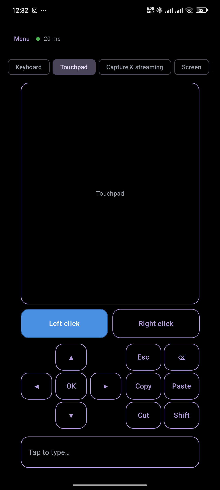
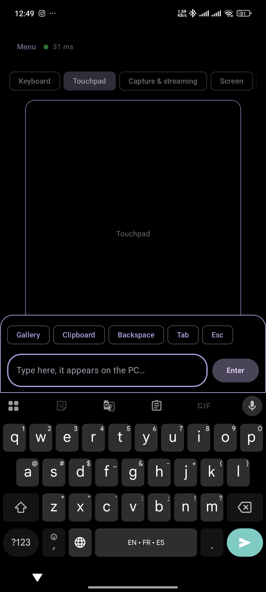
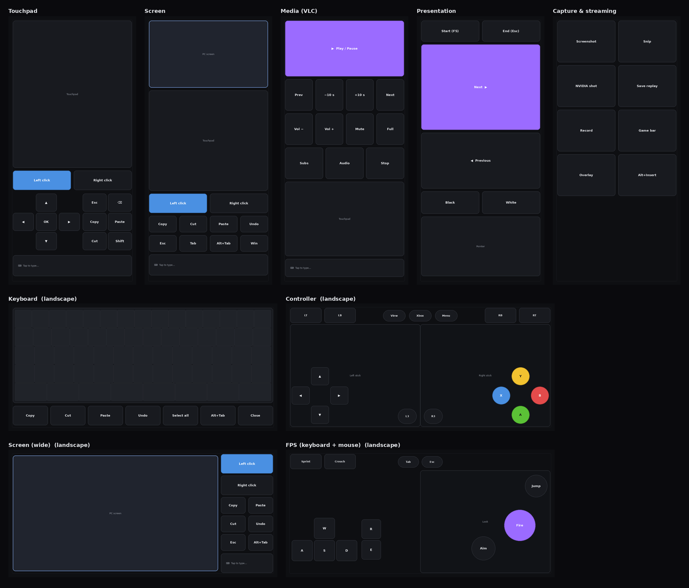

# Kitty PC

Kitty PC turns an Android phone into a configurable remote control for a
Windows, macOS, or Linux computer. The Android app includes touchpad and
full-screen remote-desktop controls, keyboard input, gamepad-style controls,
customizable profiles, and image upload. A companion Python server runs on the
computer and handles input and optional screen streaming.

## App previews

Use the large touchpad area to move the PC pointer. Tap to click, use two-finger
gestures to scroll or right-click, or use the dedicated click buttons.



Tap the "Tap to type..." field to open the typing bar and your phone keyboard.
Text you enter is sent to the PC, and the bar also gives quick access to gallery
and clipboard actions.



Kitty PC aims to make your phone a flexible wireless companion for your
computer, combining pointer control, text entry, screen streaming, and
customizable controller layouts. The included templates are starting points
for different tasks and can be adapted to your needs.



## Requirements

- **Computer/server:** Python 3.14 or newer and [uv](https://docs.astral.sh/uv/)
- **Android app:** Android Studio with the Android SDK, or an Android device
  with USB debugging enabled if installing with `adb`
- Connect the phone and computer to the same network

## Start the server

From the project root, enter the server directory and sync its dependencies:

```shell
cd server
uv sync
```

`uv sync` reads `pyproject.toml` and `uv.lock`, creates the project's virtual
environment, and installs the pinned dependencies. Run the server with:

```shell
uv run server.py
```

`uv run` runs the command using the project environment, so you do not need to
activate the virtual environment yourself. The server reads its settings from
`server/config.json`. Set its `token` to a private value before connecting your
phone; the sample value `change-me` is only a placeholder. Keep the token
private and enter the same value in the app.

By default, the server listens on UDP and TCP port `5005` and streams the
computer's screen on TCP port `5006`. Allow these ports through the computer's
firewall on your private network if the phone cannot connect. The server also
supports command-line overrides; run `uv run server.py --help` from the
`server` directory to see them. For example:

```shell
uv run server.py --host 0.0.0.0 --token "your-private-token"
```

In the app, enter the computer's local network address and the matching token.
The host must be reachable from the phone; `0.0.0.0` is a server bind address,
not the address to enter on the phone.

### Common uv commands

Run these from the `server` directory:

```shell
uv sync                 # Install dependencies from the lock file
uv run server.py        # Start the server
uv run server.py --help # Show server options
uv lock                 # Re-lock dependencies after editing pyproject.toml
```

## Install the Android app

Download `app-debug.apk` from the
[latest GitHub release](https://github.com/alcoholic-lain/Kitty-PC/releases/latest)
and install it on your Android device. Depending on your Android version, you
may need to allow installing apps from the browser or file manager used to
download the APK.

With Android platform-tools installed and USB debugging enabled, you can
instead install the APK from PowerShell at the project root:

```powershell
adb install -r .\Kitty-PC\app\build\outputs\apk\debug\app-debug.apk
```

To build a fresh debug APK locally:

```powershell
Set-Location .\Kitty-PC
.\gradlew.bat assembleDebug
```

The APK is written to
`Kitty-PC/app/build/outputs/apk/debug/app-debug.apk`.

## Repository layout

- `Kitty-PC/app/` — Android app (Kotlin and Jetpack Compose)
- `server/` — Python remote-control, input, and screen-stream server
- `Kitty-PC/tools/templates/` — controller template definitions and checks
